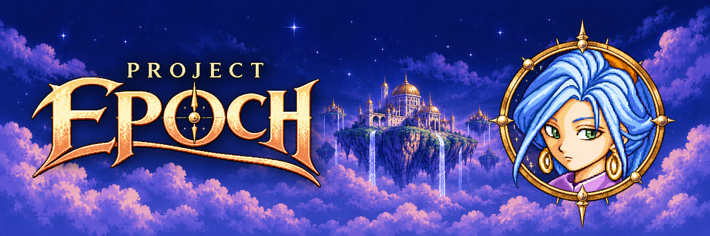

# Project Epoch visual identity — October 20, 2026

Project Epoch now has a coordinated gold wordmark, landscape hero and panoramic banner. Schala's current V6 portrait supplies the likeness in the hero and banner, with a clock cameo and a Zeal-inspired floating kingdom. These are **project artwork**, not screenshots or new in-game assets.

## Deliverables

| Asset | Dimensions | Intended use |
| --- | --- | --- |
| [Hero](../assets/branding/project-epoch-hero.png) | 1672 × 941 | Project page; complete composition on mobile |
| [Banner](../assets/branding/project-epoch-banner.png) | 2172 × 724 | Desktop portfolio entry and repository masthead |
| [Transparent logo](../assets/branding/project-epoch-logo.png) | 1983 × 793 | Standalone Project Epoch wordmark with a clock O |

The standalone logo deliberately keeps the lettering independent of the portrait for small placements. The hero and banner carry Schala. On the portfolio, images retain their complete composition with no cover crop; the homepage switches from the wide banner to the hero at 700px and below. Development warnings and descriptive headings remain real page text. Existing native screenshots remain in place as evidence.

## Collaboration and attribution

- **Andrei Pemberton:** requested the Chrono Trigger / Kingdom of Zeal direction and inclusion of Schala's portrait; established the approved portrait likeness.
- **Coda / OpenAI Codex:** composition briefs, reference selection, image-generation iterations, visual assessment, asset packaging and website integration.
- **Lily (Lilitari) / ChatGPT:** art direction and visual review of supplied actual images. Her concrete recommendation to reduce the first portrait cameo's dominance informed the revised hero and quieter panoramic banner. The session used the Personal account's 5.6 Pro after the picker showed 6 Pro locked with a usage-limit notice.
- **OpenAI image-generation tool:** generated the wordmark and scene compositions, with reference-guided portrait incorporation. These are AI-generated branding illustrations, not hand-drawn or byte-identical copies of the installed portrait.
- **Square's Chrono Trigger team and Akira Toriyama:** original game and character-design inspiration. [Official world reference](https://www.jp.square-enix.com/chronotrigger/jp/world.html) and [Schala concept reference](https://www.creativeuncut.com/gallery-01/ct-schala.html). [Chrono Trigger logo reference preserved on Wikimedia Commons](https://commons.wikimedia.org/wiki/File:Chrono_Trigger_Logo.png) informed the title's typographic energy; the new wordmark spells Project Epoch.

## Reproduction and evidence

The [asset manifest](../references/project_epoch_branding_2026_10_20.json) records exact delivered file hashes, dimensions, source roles and generation prompts. Copying the checked-in PNGs reproduces the delivered assets byte-for-byte. Re-running an image-generation prompt is nondeterministic and is not expected to reproduce those bytes. The initial hero was refined once after Lily's review; the delivered hero is that second composition.

Evidence level: **generated artwork, visually inspected**. Logo alpha was checked programmatically. This branding task changes no ROM, sprite binding, portrait encoding, gameplay or game-validation claim. The project remains **IN DEVELOPMENT — NOT YET TRULY PLAYABLE**. Consult the separate [development update](project_epoch_development_update_2026_10_20.md) for actual native evidence and open work.

[Full human and AI credits](../CREDITS.md) · [Portfolio art downloads](https://richard-pemberton-research.darkahn.chatgpt.site/projects/project-epoch/branding/)
